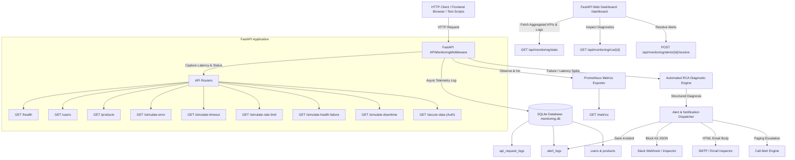

# System Architecture: FastAPI API Sentinel & Telemetry Store

## Overview
FastAPI API Sentinel is an end-to-end monitoring, performance tracking, alerting, and Root Cause Analysis (RCA) platform built around a high-performance FastAPI service. It captures full-fidelity request telemetry into a persistent SQLite database (running in WAL mode) and exposes standard Prometheus metrics for Prometheus/Grafana or Datadog scrapers.

## Key Components

### 1. `APIMonitoringMiddleware`
- Wraps every incoming request with high-resolution timer (`time.perf_counter()`).
- Injects `X-Request-ID` (UUIDv4) and `X-Response-Time-Ms` headers.
- Intercepts all unhandled exceptions (catching 500 crashes and extracting full stack traces).
- Dispatches SQLite writes, alert evaluation, and notification I/O as Starlette `BackgroundTasks` after the response is prepared so the client is not blocked on disk or SMTP.

### 2. SQLite Database with WAL Mode
- Configured via SQLAlchemy with Write-Ahead Logging (`PRAGMA journal_mode=WAL`) and `PRAGMA busy_timeout=5000`.
- Allows concurrent multi-threaded writes and reads without database locks.
- Persists:
  * `api_request_logs`: High-resolution telemetry for every request.
  * `alert_logs`: Auditable incident log with root cause summaries and runbooks.
  * `users` and `products`: Realistic business domain entities.

### 3. Prometheus Observability
- Exposes standard `/metrics` endpoint using `prometheus_client`.
- Gauges: System CPU, RAM, Disk, Uptime, Active Alerts, Error Rate (`fastapi_system_disk_percent`, `fastapi_error_rate_percent`).
- Counters: `fastapi_requests_total` partitioned by `method`, `endpoint`, and `status_code`.
- Histograms: `fastapi_request_duration_seconds` across fine-grained latency buckets.

### 4. Automated Root Cause Analysis (RCA) Engine
- When any failure (401, 429, 500, 503, elevated error rate, or latency > 3.0s) occurs, the RCA engine automatically analyzes:
  * HTTP status code and path
  * Duration vs SLA (3000ms threshold)
  * Exception name and traceback stack frame
  * Client IP and authorization headers
- Generates a human-readable diagnosis and an actionable 3-step runbook remediation.
